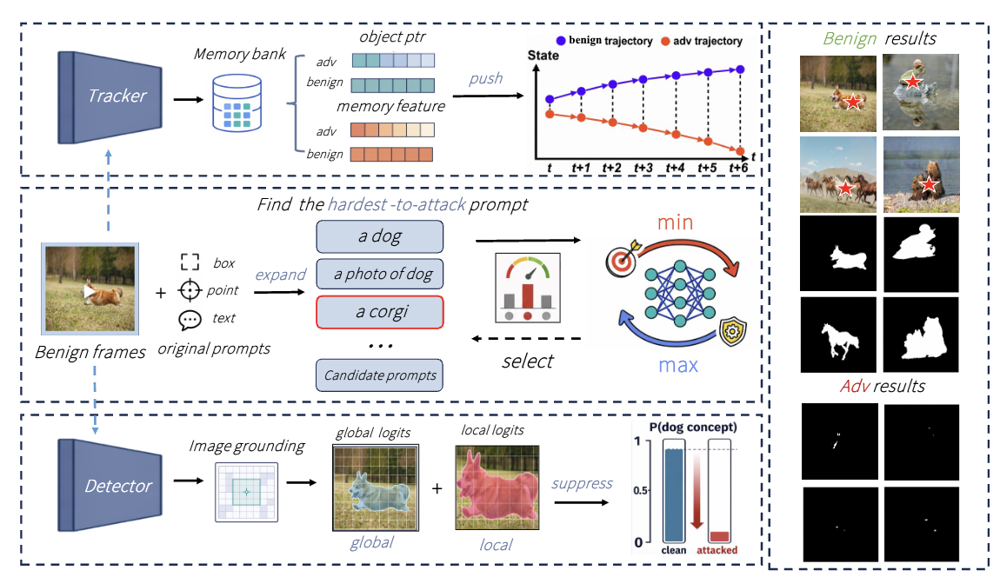

# AdvPCS
This repository contains the released code for "Universal Cross-Prompt Adversarial Attacks on Promptable Concept Segmentation".




## Overview

AdvPCS provides training and evaluation code for universal cross-prompt adversarial attacks on SAM3-based promptable concept segmentation models. The released code is located in `sam3_uap_release/`.

## Requirements

- Install the official SAM3 environment and dependencies by following `sam3_uap_release/sam3/README.md`.
- Place `sam3.pt` and `config.json` under `sam3_uap_release/checkpoints/`.
- Keep `bpe_simple_vocab_16e6.txt.gz` under `sam3_uap_release/assets/`.
- Place datasets under `sam3_uap_release/data/`, or set `SAM3_UAP_DATA_ROOT`, `SAM3_UAP_CKPT_ROOT`, and `SAM3_UAP_OUTPUT_ROOT` to custom paths.

## Run

Train a universal perturbation:

```shell
python sam3_uap_release/attack/uap_modular/uapattack_modular.py \
  --train_dataset SACO \
  --train_prompts text \
  --limit_img 100 \
  --limit_frames 15 \
  --uap_epochs 15 \
  --save_delta predlogit_uap_delta_modular.pt
```

Evaluate on SACO text prompts:

```shell
python sam3_uap_release/attack/eval_uap_delta.py \
  --delta_path predlogit_uap_delta_modular_epoch15.pt \
  --train_dataset SACO \
  --test_prompts text
```

Evaluate cross-prompt transfer on YOUTUBE point and box prompts:

```shell
python sam3_uap_release/attack/eval_uap_delta.py \
  --delta_path predlogit_uap_delta_modular_epoch15.pt \
  --train_dataset YOUTUBE \
  --test_prompts pt

python sam3_uap_release/attack/eval_uap_delta.py \
  --delta_path predlogit_uap_delta_modular_epoch15.pt \
  --train_dataset YOUTUBE \
  --test_prompts bx
```

## Main Entry Points

- `sam3_uap_release/attack/uap_modular/uapattack_modular.py`
- `sam3_uap_release/attack/eval_uap_delta.py`
